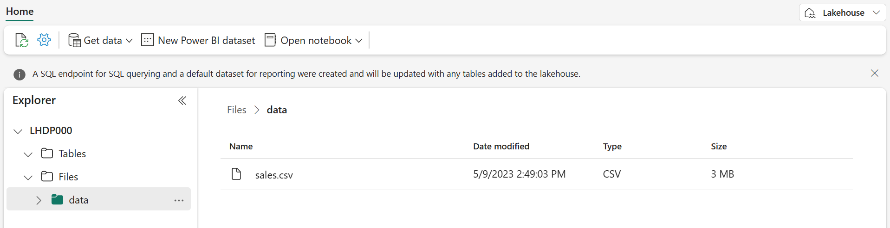
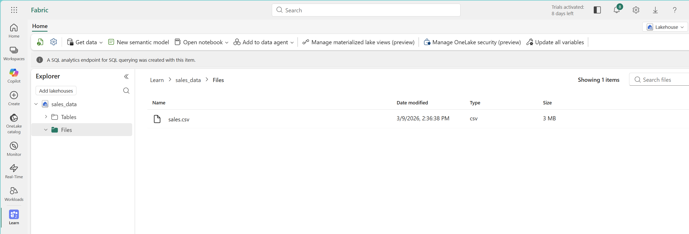
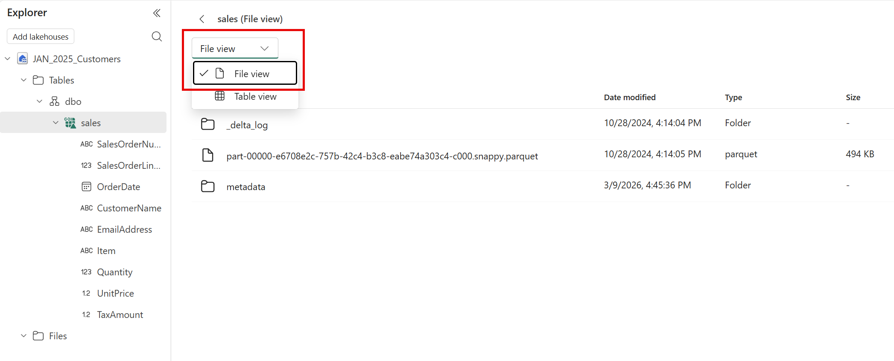
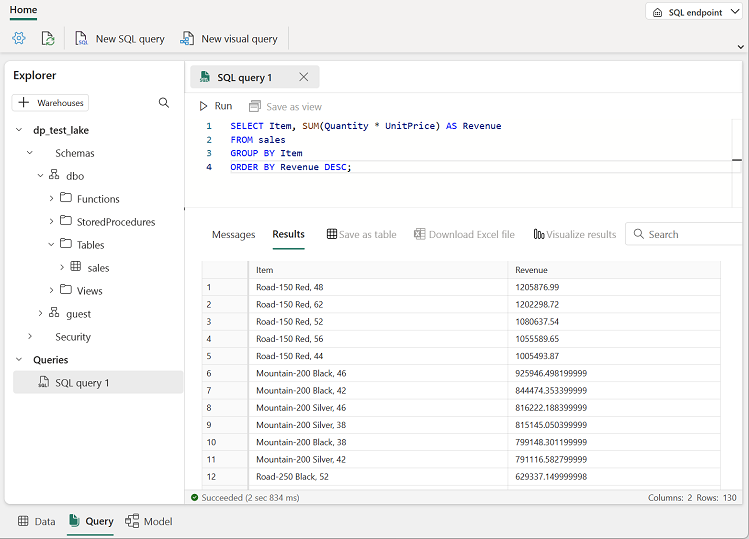

# Lab 1: Work with a Fabric lakehouse

In this lab you land the raw files of the Adventure Works business in your lakehouse. These files are the **bronze** layer: data exactly as it arrived. You also see how a lakehouse combines file storage and table storage in OneLake, load one file into a managed Delta table, and query it with SQL.

**Approximate time:** 30 minutes

> **Start here:** Open your **Macula-FabricDemo-Workshop** workspace and select your **FabricWorkshopDemo** lakehouse.

## Upload the raw files

Fabric gives you several ways to load data into a lakehouse, including pipelines (the next lab) and Dataflows Gen2. One of the simplest ways to bring in a small amount of data is to upload files from your computer. You upload three groups of files into three folders. The notebooks in Labs 3 and 4 expect these exact folder names.

1. In the **Explorer** pane, open the **...** menu for the **Files** folder, select **New subfolder**, and create a subfolder named `data`. Create two more subfolders under **Files** named `bronze` and `products`.
1. Open the **...** menu for the **data** folder, select **Upload** > **Upload files**, and upload **sales.csv** from the repo you downloaded (`Labs/Lab1/Assets/sales.csv`).
1. Open the **...** menu for the **bronze** folder, select **Upload** > **Upload files**, and upload the three files in `Labs/Lab1/Assets/bronze`: `2019.csv`, `2020.csv`, and `2021.csv`. Hold the Shift key to select all three at once.
1. Open the **...** menu for the **products** folder, select **Upload** > **Upload files**, and upload `Labs/Lab1/Assets/products.csv`.
1. Select each folder in turn and verify that it lists the right files:

    | Folder | Files |
    | --- | --- |
    | `Files/data` | `sales.csv` |
    | `Files/bronze` | `2019.csv`, `2020.csv`, `2021.csv` |
    | `Files/products` | `products.csv` |

    

1. Select **sales.csv** to preview it. Then select **2019.csv** in the **bronze** folder and compare. `sales.csv` has a header row with column names. The yearly files do not: the first line is already an order. Keep that in mind for Lab 3.

## Load file data into a table

Analysts and engineers can work with files directly using Apache Spark. In many cases, though, you want the data in a table so you can query it with SQL.

1. In the **Explorer** pane, select the **Files/data** folder so you can see **sales.csv**.
1. Open the **...** menu for **sales.csv** and select **Load to Tables** > **New table**.
1. In the **Load to table** dialog, set the table name to `sales`. If you are asked for the file type, select **CSV**, make sure the header option is selected, then confirm the load and wait for the table to be created.

    > **Tip:** If the `sales` table does not appear automatically, open the **...** menu for the **Tables** folder and select **Refresh**.

1. Select the `sales` table in the **Explorer** pane to view its data.

    

1. Open the **...** menu for the `sales` table and select **View files** to see the files behind the table.

    

    The files for a Delta table are stored in *Parquet* format. They include a subfolder named **_delta_log**, which records every transaction applied to the table. You will meet Delta tables again in Labs 3 and 4.

## Use SQL to query tables

When you create a lakehouse and define tables in it, Fabric automatically creates a SQL analytics endpoint so you can query the tables with SQL `SELECT` statements.

1. At the top right of the lakehouse page, switch from **Lakehouse** to **SQL analytics endpoint**. Wait a moment for the SQL analytics endpoint to open.
1. Select **New SQL query** and enter the following query:

    ```sql
    SELECT Item, SUM(Quantity * UnitPrice) AS Revenue
    FROM sales
    GROUP BY Item
    ORDER BY Revenue DESC;
    ```

    > **Tip:** You can also copy this query from `Labs/Lab1/Assets/01-Snippets.txt`.

1. Select **&#9655; Run**. The results show total revenue for each product.

    

## If you finish early

- **Explore shortcuts.** Open the **...** menu for the **Files** folder and select **New shortcut**. Look through the data source types (ADLS Gen2, Amazon S3, Google Cloud Storage, Dataverse, other OneLake locations), then close the dialog without creating one. A shortcut lets you use data stored elsewhere without copying it.
- **Create a visual query.** On the SQL analytics endpoint toolbar, expand **New SQL query** and select **New visual query**. Drag the `sales` table onto the canvas and use **Transform** > **Group by** to count the lines on each order.

## Tips and things to watch for

- **Use the exact folder names.** `data`, `bronze` and `products` are case-sensitive. The notebooks in Labs 3 and 4 read from these folders and fail with a path error if a name is different.
- **Upload the real CSV.** Use the files from the unzipped repo. A file saved from the GitHub web page is an HTML page with a `.csv` name, and it will not load into a table correctly.
- **Check the columns after Load to Tables.** `sales.csv` has a header row, so the `sales` table should have named columns such as `SalesOrderNumber` and `Item`. If the columns are named `c0`, `c1`, and so on, or the SQL query says a column cannot be found, delete the table and load it again with the header option selected.
- **Files and Tables are different places.** Files holds any file. Only Delta tables in Tables can be queried with SQL, which is why you load the CSV into a table.
- **The SQL analytics endpoint can lag a little.** If the `sales` table is not there yet when you switch to the **SQL analytics endpoint**, wait a minute and refresh. It syncs from the lakehouse in the background. See [SQL analytics endpoint metadata sync](https://learn.microsoft.com/fabric/data-engineering/sql-analytics-endpoint-metadata-sync).
- **Check which view you are in.** Use the switch at the top right: **Lakehouse** for files and notebooks, **SQL analytics endpoint** for T-SQL queries.

**Learn more**

- [What is a lakehouse in Microsoft Fabric?](https://learn.microsoft.com/fabric/data-engineering/lakehouse-overview)
- [OneLake, the OneDrive for data](https://learn.microsoft.com/fabric/onelake/onelake-overview)
- [OneLake shortcuts](https://learn.microsoft.com/fabric/onelake/onelake-shortcuts)

## What you learned

A lakehouse stores files and Delta tables together in OneLake. You landed three groups of raw files, the first part of your bronze layer, and queried one of them with SQL. In the next lab you bring in the last bronze source automatically with a pipeline.

**Next:** [Lab 2: Ingest data with a pipeline](../Lab2/02-ingest-pipeline.md)
