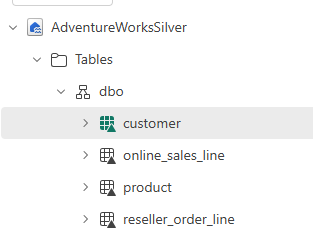

# Lab 3: Explore bronze and build silver

Raw data is rarely ready to use. In this lab you run two Spark notebooks. The first explores your bronze layer and finds what is wrong with it. The second fixes those problems and writes clean **silver** tables in a new lakehouse. You do not type any code: you run each notebook as it is and your facilitator explains the key cells.

**Approximate time:** 30 minutes

> **Start here:** Open your **Macula-FabricDemo-Workshop** workspace. You need the bronze data from Labs 1 and 2 in your **FabricWorkshopDemo** lakehouse.

## What is a medallion architecture?

| Layer | Purpose | Rule of thumb |
| --- | --- | --- |
| **Bronze** | Keep the data exactly as it arrived, so any later step can be replayed | Never edited, only read |
| **Silver** | One clean, typed, deduplicated table per business thing, with the same rules for every source | Fix data quality here, once |
| **Gold** | Shaped for questions: facts (what happened) and dimensions (who, what, when, how) | What reports, Kenseme and agents read |

In this workshop each layer has its own lakehouse: `FabricWorkshopDemo` (bronze), `AdventureWorksSilver` and `AdventureWorksGold`.

## Create the silver lakehouse

1. In your workspace, select **+ New item**, search for **Lakehouse**, and create a lakehouse named `AdventureWorksSilver`.
1. Leave the **Lakehouse schemas** checkbox **selected**. Both notebooks use the `dbo` schema.

> **Tip:** Type the name exactly. Lab 5 and the notebooks look it up by name.

## Import the two notebooks

1. In your workspace, select **Import** > **Notebook** > **From this computer**.
1. Select these two files from the repo you downloaded and open them: `Labs/Lab3/Assets/00-Bronze-Explore-the-raw-data.ipynb` and `Labs/Lab3/Assets/01-Silver-Clean-and-conform.ipynb`.
1. Verify that both notebooks appear in your workspace.

## Part 1: Explore the bronze data

1. Open the notebook **00-Bronze-Explore-the-raw-data**.
1. In the **Explorer** pane, select **Add data items** > **From OneLake catalog**, choose **AdventureWorksSilver**, and select **Connect**. This is the notebook's *default lakehouse*. The notebook finds your **FabricWorkshopDemo** bronze lakehouse by name.
1. Run the notebook one cell at a time with **&#9655; Run cell**, and read each result before you move on. The first cell is slow because a Spark session has to start.

    > **Note:** Your facilitator pauses at each finding. Do not use **Run all** here.

1. Compare your results with the five findings:

    | Finding | What you should see | What silver will do |
    | --- | --- | --- |
    | 1. Every online line arrives twice | `sales.csv` has 32,718 lines. The yearly files have 32,718 lines. Together, distinct by order and line, there are still only 32,718. | Keep one row per order number and line number |
    | 2. Customers have no id | 12,427 distinct e-mail addresses but only 12,387 distinct names, so a name is not a safe key. Orders run from 2019-07-01 to 2021-12-31. | Use the lower-case e-mail as the customer key |
    | 3. Products are referenced by name | 130 products sold online, 0 names missing from the catalog | Keep the name to join the catalog, which has the id |
    | 4. One name packs model, color and size | For example `Mountain-100 Silver, 44` | Split into model, color and variant |
    | 5. Reseller orders have a different shape | 542 lines and 32 orders, a line total instead of a unit price, and resellers pay about 58% of list price | Give both channels the same column names |

## Part 2: Build the silver layer

1. Open the notebook **01-Silver-Clean-and-conform**.
1. In the **Explorer** pane, select **Add data items** > **From OneLake catalog**, choose **AdventureWorksSilver**, and select **Connect**. Silver tables are saved in this default lakehouse.
1. Select **Run all**. The run takes about 2 minutes once Spark has started. While it runs, follow along as your facilitator explains each section:
    - **Online order lines:** reads all four files, keeps one row per order line, and converts every column to its proper type.
    - **Quality checks:** `assert` statements stop the run before bad data is saved.
    - **Reseller order lines:** gives reseller lines the same column names as the online lines.
    - **Products:** splits the product name and adds the category group (Bikes, Components, Clothing, Accessories).
    - **Customers:** creates one customer per e-mail address for the web store and one per account, prefixed `RS-`, for resellers.
1. When the run finishes, read the last result, **Bronze vs Silver**. The silver counts should be:

    | Silver table | Rows |
    | --- | --- |
    | `online_sales_line` | 32,718 |
    | `reseller_order_line` | 542 |
    | `product` | 295 |
    | `customer` | 12,459 |

    The comparison shows 65,436 online lines in bronze against 32,718 in silver, with the same 16,459 orders. Summing bronze as it is would double the online revenue. That is the kind of error silver exists to prevent.

1. In the **Explorer** pane of the notebook, open the **...** menu for **Tables**, select **Refresh**, and verify that your lakehouse shows the four tables:

    

1. Select **Run** > **Stop session** on both notebooks so they release their compute for the next lab.

## If you finish early

Open the **customer** table in the **AdventureWorksSilver** lakehouse and find a row with `CustomerType` of `Reseller`. Compare its `CustomerAlternateKey` with an online customer's. Why does silver add the `RS-` prefix?

## Tips and things to watch for

- **Run the notebooks in order.** Silver reads the bronze layer, and Lab 4 reads silver.
- **Attach the right lakehouse.** Notebook 01 must have **AdventureWorksSilver** as its default lakehouse. If you see an error such as *table or view not found*, remove the lakehouse and add it again with **Add data items**.
- **A path error means a folder name is different.** Check that Lab 1 created `Files/data`, `Files/bronze`, and `Files/products`, and that Lab 2 created `dbo.orders`.
- **A failed `assert` is the notebook doing its job.** The message says what is wrong with the data. Tell your facilitator.
- **The first cell is slow, the rest are fast.** Starting a Spark session takes a minute or two. If you see `TooManyRequestsForCapacity` (HTTP 430), stop any other notebook sessions, wait a minute, and run the cell again.
- **Re-running is safe.** Each silver table is overwritten, so a second run gives the same result.
- **Stop your session when you finish.** An idle session still holds compute that other people in the room need.

**Learn more**

- [What are Delta tables in Fabric?](https://learn.microsoft.com/fabric/data-engineering/lakehouse-and-delta-tables)
- [Medallion lakehouse architecture](https://learn.microsoft.com/fabric/onelake/onelake-medallion-lakehouse-architecture)
- [How to use notebooks in Fabric](https://learn.microsoft.com/fabric/data-engineering/how-to-use-notebook)

## What you learned

You explored raw data and found five problems. You then ran a notebook that fixed all of them with written rules and saved clean Delta tables in a silver lakehouse. In Lab 4 you shape silver into a gold star schema.

**Previous:** [Lab 2: Ingest data with a pipeline](../Lab2/02-ingest-pipeline.md)

**Next:** [Lab 4: Build the gold layer](../Lab4/04-build-gold-layer.md)
