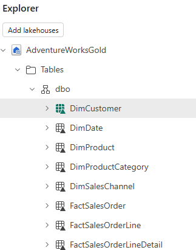

# Lab 4: Build the gold layer

Silver is clean, but it is still shaped like the source systems. Gold is shaped for questions. In this lab you run a notebook that turns your silver tables into a **star schema**: facts that record what happened and dimensions that describe who, what, when and how. You declare the keys that connect the tables, then check the result by answering business questions in SQL. In Lab 5, Kenseme reads this gold lakehouse to build an ontology.

You do not type any code in this lab. You run each notebook as it is and your facilitator explains the key cells.

**Approximate time:** 30 minutes

> **Start here:** Open your **Macula-FabricDemo-Workshop** workspace. You need the silver tables from Lab 3 in your **AdventureWorksSilver** lakehouse.

## The star schema you will build

```text
                     DimDate              DimSalesChannel
                        |                        |
  DimCustomer ---- FactSalesOrder ---------------+          one row per order (header, totals)
                        |
                 FactSalesOrderLine ---- DimProduct ---- DimProductCategory
                 one row per line

  FactSalesOrderLineDetail: the same lines, flattened with their order number, customer and order date
```

| Kind | Answers | Tables |
| --- | --- | --- |
| **Facts** | *What happened*: orders, quantities, money | `FactSalesOrder`, `FactSalesOrderLine` |
| **Flat line table** | One row per line with everything about it, so an ontology can bind one table per class | `FactSalesOrderLineDetail` |
| **Dimensions** | *Who, what, when, how* you slice by | `DimCustomer`, `DimProduct`, `DimProductCategory`, `DimDate`, `DimSalesChannel` |

## Create the gold lakehouse and import the notebooks

1. In your workspace, select **+ New item**, search for **Lakehouse**, and create a lakehouse named `AdventureWorksGold`.
1. Leave the **Lakehouse schemas** checkbox **selected**.

    > **Tip:** Type the name exactly. Lab 5 binds the ontology to a lakehouse with this name.

1. In your workspace, select **Import** > **Notebook** > **From this computer**, and select these two files from the repo you downloaded: `Labs/Lab4/Assets/02-Gold-Sales-star-schema.ipynb` and `Labs/Lab4/Assets/03-Gold-Business-questions.ipynb`.

## Part 1: Build the gold tables

1. Open the notebook **02-Gold-Sales-star-schema**.
1. In the **Explorer** pane, select **Add data items** > **From OneLake catalog**, choose **AdventureWorksGold**, and select **Connect**.
1. Select **Run all**. The run takes about 3 minutes once Spark has started. While it runs, follow along as your facilitator explains each section:
    - **Dimensions:** `DimSalesChannel` has two rows. Categories and products get numeric keys. Customers get a key in order of their first purchase, and the name is split into first and last name. `DimDate` has one row for every day.
    - **Conform both channels:** online and reseller lines get the same columns, so one query can answer questions about both.
    - **Facts:** `FactSalesOrderLine` has one row per line. `FactSalesOrder` has one row per order, with its totals.
    - **The flat line table:** `FactSalesOrderLineDetail` repeats the order number, customer and date on every line.
    - **Checks:** every foreign key must find its row, and gold revenue must equal silver revenue.

    > **Why are the money columns `double` in the flat table?** The Fabric graph that Kenseme publishes to loads decimal columns as empty values. The other tables keep exact decimals.

1. When the run finishes, the notebook prints the rows it saved for each table. They should match:

    | Table | Rows |
    | --- | --- |
    | `DimSalesChannel` | 2 |
    | `DimProductCategory` | 37 |
    | `DimProduct` | 295 |
    | `DimCustomer` | 12,459 |
    | `DimDate` | 1,280 |
    | `FactSalesOrderLine` | 33,260 |
    | `FactSalesOrder` | 16,491 |
    | `FactSalesOrderLineDetail` | 33,260 |

1. Check the two result tables near the end. In the first, every value in the **orphans** column is **0**. In the second, both channels show **OK**. The expected total revenue is **21,636,712.50**.
1. Open the **...** menu for **Tables** in the **Explorer** pane, select **Refresh**, and verify that all eight tables are listed:

    

## Part 2: Declare the keys

Spark cannot declare keys, so you do it on the SQL analytics endpoint. The keys are informational: they are not enforced. Kenseme reads them. It turns each foreign key into a relationship in the ontology and uses the keys when it binds the ontology to your tables.

1. In your workspace, open the **AdventureWorksGold** lakehouse and switch from **Lakehouse** to **SQL analytics endpoint** at the top right. Check that all eight tables are listed. If they are not, wait a minute and refresh.
1. Select **New SQL query**.
1. Open `Labs/Lab4/Assets/declare_keys_gold.sql` from the repo, copy all of its contents, paste them into the query window, and select **&#9655; Run**.
1. Check the result. Run this query in a new query window:

    ```sql
    SELECT OBJECT_NAME(parent_object_id) AS tbl, name FROM sys.key_constraints
    UNION ALL
    SELECT OBJECT_NAME(parent_object_id), name FROM sys.foreign_keys;
    ```

    You should see **17** rows: 8 primary keys and 9 foreign keys.

    > **Note:** If you run the script twice, the second run reports that the keys already exist. That is harmless.

## Part 3: Ask business questions in SQL

Now check that the star schema works. The notebook **03-Gold-Business-questions** answers eight business questions in SQL. These are the reference answers: in Lab 5, a data agent must return the same figures.

1. Open the notebook **03-Gold-Business-questions**.
1. In the **Explorer** pane, select **Add data items** > **From OneLake catalog**, choose **AdventureWorksGold**, and select **Connect**.
1. Select **Run all**. Every query follows the same pattern: start from a fact, join the dimensions you slice by, add up.
1. Find these two answers:

    | Question | Expected answer |
    | --- | --- |
    | **Q3.** Orders, revenue and average order value by channel | Online: 16,459 orders, 20,928,022.43, average 1,271.52. Reseller: 32 orders, 708,690.07, average 22,146.56. |
    | **Q7.** Repeat online customers | 3,310 of 12,427 customers (26.6%) ordered more than once. |

    Look at the section **Why Gold?** at the end. The same channel question on silver needs a separate query for each source and a `UNION`. On gold it is one join. Every consumer (reports, Kenseme, agents) gets the same answer, because the rules live in one place.

1. Select **Run** > **Stop session** on both notebooks.

## If you finish early

Compare **Q1** (revenue by product category group and year) with the other questions. Online sales run from 2019 to 2021 and reseller sales are in 2022, so 2022 shows the reseller mix. Which category group grows fastest?

## Tips and things to watch for

- **Run the notebooks in order.** Gold reads silver, and the questions read gold.
- **The default lakehouse must be AdventureWorksGold** for notebooks 02 and 03. If you see an error such as *table or view not found*, remove the lakehouse and add it again with **Add data items**.
- **The keys script says an object does not exist.** The SQL analytics endpoint has not seen the tables yet. Wait a minute, refresh, and run the script again.
- **Re-running the gold notebook is safe.** It overwrites the rows and keeps the keys.
- **A run takes about 3 minutes.** If it fails with `TooManyRequestsForCapacity` (HTTP 430), stop any other notebook sessions, wait a minute, and run again.
- **Stop your sessions when you finish.** An idle session holds compute that other people in the room need.

**Learn more**

- [Dimensional modeling in Fabric Data Warehouse](https://learn.microsoft.com/fabric/data-warehouse/dimensional-modeling-overview)
- [SQL analytics endpoint metadata sync](https://learn.microsoft.com/fabric/data-engineering/sql-analytics-endpoint-metadata-sync)
- [Medallion lakehouse architecture](https://learn.microsoft.com/fabric/onelake/onelake-medallion-lakehouse-architecture)

## What you learned

You built a medallion architecture: raw files in bronze, clean tables in silver, and a star schema in gold with declared keys. Anyone can now answer a business question with one join. In Lab 5 you give this gold layer business meaning with an ontology.

**Previous:** [Lab 3: Explore bronze and build silver](../Lab3/03-explore-bronze-build-silver.md)

**Next:** [Lab 5: Give your data meaning with an ontology](../Lab5/05-kenseme-ontology.md)
